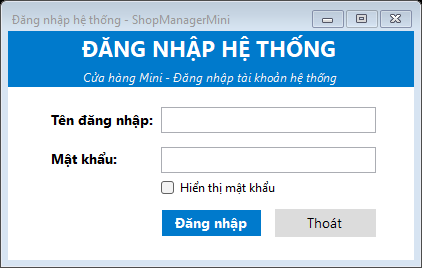
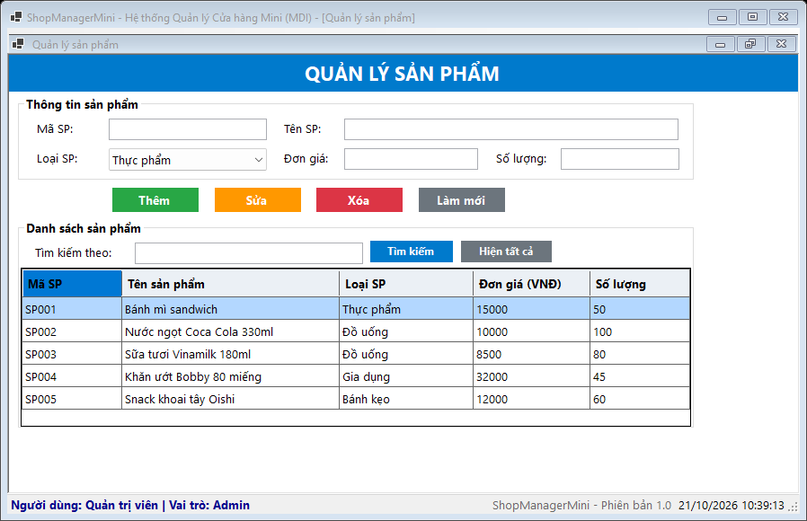
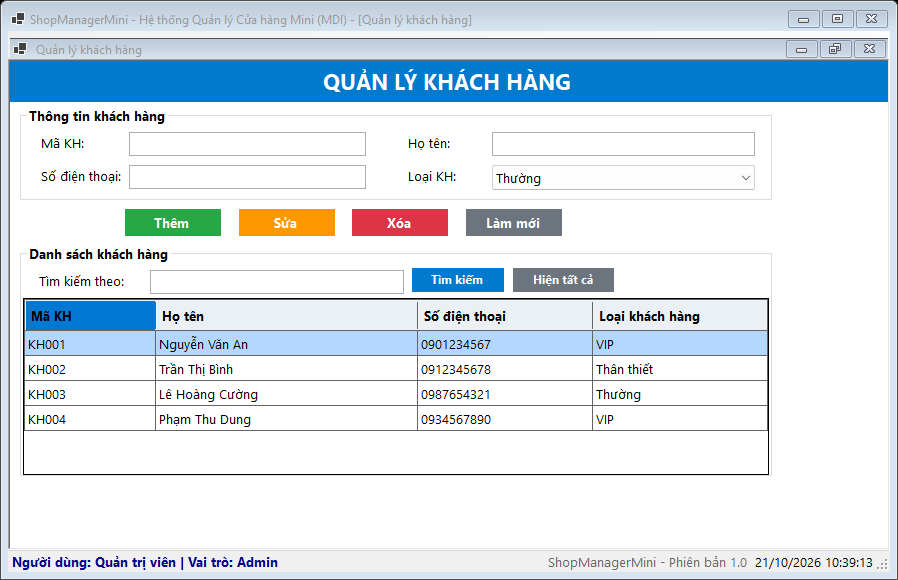
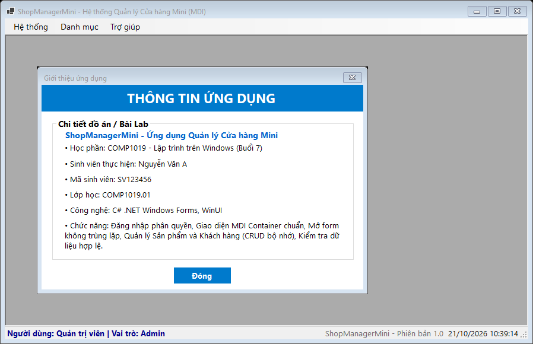

# ShopManagerMini

Ứng dụng quản lý cửa hàng mini nhiều Form, viết bằng **C# WinForms (.NET 8)**.
Bài Lab 07 – môn **COMP1019 – Lập trình trên Windows** (SDI, MDI và ứng dụng nhiều Form).

## Yêu cầu môi trường

- Windows 10/11
- Visual Studio 2022 (workload **.NET desktop development**) và .NET 8 SDK
- Không cần SQL Server: toàn bộ dữ liệu lưu trong bộ nhớ (`BindingList<T>`), tắt chương trình là quay về dữ liệu mẫu.

## Cách chạy

1. Mở file `ShopManagerMini.sln` hoặc `ShopManagerMini.csproj` bằng Visual Studio.
2. Nhấn **F5** (hoặc *Debug > Start Debugging*).
3. Đăng nhập bằng một trong các tài khoản mẫu bên dưới.

Hoặc chạy bằng dòng lệnh:

```bash
dotnet run --project ShopManagerMini.csproj
```

Nếu dùng phiên bản .NET khác, sửa `TargetFramework` trong `ShopManagerMini.csproj`.

## Tài khoản mẫu

| Username | Password | Họ tên             | Vai trò |
|----------|----------|--------------------| --------|
| admin    | 123      | Quản trị viên      | Admin   |
| user     | 123      | Nhân viên bán hàng | User    |

## Chức năng

**Đăng nhập (`FrmLogin`)**
- Mở bằng `ShowDialog()`, trả `DialogResult.OK` khi đúng tài khoản.
- Cảnh báo khi bỏ trống, báo lỗi khi sai username/password.
- Hỗ trợ checkbox "Hiển thị mật khẩu" và phím Enter để đăng nhập nhanh.

**Form chính (`FrmMain`, MDI Parent)**
- Menu *Hệ thống* (Đăng xuất, Thoát), *Danh mục* (Quản lý sản phẩm, Quản lý khách hàng), *Trợ giúp* (Giới thiệu).
- StatusStrip hiển thị tên người dùng, vai trò, phiên bản ứng dụng và thời gian hiện tại (cập nhật mỗi giây).
- Form con mở bên trong Form chính; bấm menu nhiều lần chỉ kích hoạt lại Form đã mở, không tạo trùng.
- Hỏi xác nhận khi thoát hoặc đăng xuất.

**Quản lý sản phẩm (`FrmProduct`)**
- Thông tin: mã SP, tên SP, loại SP, đơn giá (VNĐ), số lượng.
- Thêm, Sửa, Xóa, Làm mới, Tìm kiếm (theo mã, tên, loại) và Hiện tất cả trên DataGridView.
- Kiểm tra: không để trống, không trùng mã, đơn giá và số lượng không âm.
- Hỏi xác nhận trước khi xóa.
- Dữ liệu mẫu sẵn: Bánh mì sandwich, Nước ngọt Coca Cola, Sữa tươi Vinamilk, Khăn ướt Bobby, Snack Oishi.

**Quản lý khách hàng (`FrmCustomer`)**
- Thông tin: mã KH, họ tên, số điện thoại, loại khách hàng.
- Thêm, Sửa, Xóa, Làm mới, Tìm kiếm (theo mã, tên, số điện thoại) và Hiện tất cả.
- Kiểm tra: không để trống, không trùng mã.
- Dữ liệu mẫu sẵn: Nguyễn Văn An (VIP), Trần Thị Bình (Thân thiết), Lê Hoàng Cường (Thường), Phạm Thu Dung (VIP).

**Giới thiệu (`FrmAbout`)**: thông tin ứng dụng, học phần, sinh viên, lớp, công nghệ sử dụng.

## Cách sử dụng nhanh (Sản phẩm / Khách hàng)

- **Thêm**: nhập thông tin vào các ô rồi bấm *Thêm*.
- **Sửa**: chọn một dòng trong danh sách (mã bị khóa), đổi thông tin rồi bấm *Sửa*.
- **Xóa**: chọn một dòng rồi bấm *Xóa* và xác nhận.
- **Làm mới**: xóa ô nhập, bỏ chọn và hiển thị lại toàn bộ danh sách.
- **Tìm kiếm**: nhập từ khóa rồi bấm *Tìm kiếm*; bấm *Hiện tất cả* hoặc *Làm mới* để quay lại danh sách đầy đủ.

## Cấu trúc project

```
ShopManagerMini
|-- Models
|   |-- User.cs            # lớp tài khoản người dùng
|   |-- Product.cs          # lớp sản phẩm
|   |-- Customer.cs         # lớp khách hàng
|   |-- DataStore.cs        # dữ liệu mẫu và kho dữ liệu trong bộ nhớ
|
|-- Forms
|   |-- FrmLogin.cs         # form đăng nhập (Modal Dialog)
|   |-- FrmMain.cs          # form chính MDI Parent
|   |-- FrmProduct.cs       # form quản lý sản phẩm (CRUD)
|   |-- FrmCustomer.cs      # form quản lý khách hàng (CRUD)
|   |-- FrmAbout.cs         # form giới thiệu ứng dụng
|
|-- Program.cs              # vòng lặp Đăng nhập -> Form chính -> Đăng xuất
|-- Screenshots             # ảnh chụp các màn hình chính
|-- CAU_HOI_TRA_LOI.md      # trả lời 5 câu hỏi nộp kèm
```

## Luồng truyền dữ liệu

`FrmLogin` lưu người dùng vào property `LoggedInUser` → `Program.cs` đọc sau `ShowDialog()` → truyền vào constructor `FrmMain(User user)` → hiển thị lên StatusStrip.

```
Program.cs ──ShowDialog()──> FrmLogin
                                │
                     LoggedInUser (property)
                                │
Program.cs ──new FrmMain(user)──> FrmMain (MDI Parent)
                                    ├── FrmProduct  (MDI Child)
                                    ├── FrmCustomer (MDI Child)
                                    └── FrmAbout    (MDI Child)
```

## Ảnh minh họa

**1. Màn hình đăng nhập (`FrmLogin`)**

Form đăng nhập dạng Modal Dialog, có TextBox nhập username/password, checkbox hiển thị mật khẩu, nút Đăng nhập và Thoát.



---

**2. Quản lý sản phẩm (`FrmProduct`) — Form con MDI**

Giao diện CRUD sản phẩm với GroupBox thông tin, các nút Thêm/Sửa/Xóa/Làm mới, ô tìm kiếm và DataGridView hiển thị danh sách. Form mở bên trong FrmMain (MDI Child), StatusStrip hiển thị người dùng, vai trò và thời gian.



---

**3. Quản lý khách hàng (`FrmCustomer`) — Form con MDI**

Giao diện CRUD khách hàng tương tự sản phẩm: nhập thông tin mã KH, họ tên, số điện thoại, loại KH; có tìm kiếm và DataGridView. Dữ liệu mẫu gồm 4 khách hàng với các loại VIP, Thân thiết, Thường.



---

**4. Giới thiệu ứng dụng (`FrmAbout`) — Form con MDI**

Hiển thị thông tin đồ án: tên ứng dụng, học phần COMP1019, sinh viên thực hiện, mã sinh viên, lớp học, công nghệ sử dụng và các chức năng chính. Phía trên là MenuStrip của FrmMain (Hệ thống, Danh mục, Trợ giúp).



## Ghi chú

- Giao diện được dựng bằng code (không dùng Designer drag-drop).
- Dữ liệu chỉ lưu trong bộ nhớ (`BindingList<T>` và `List<T>`), chưa kết nối cơ sở dữ liệu.
- Dữ liệu mẫu được khởi tạo sẵn trong `DataStore.cs`, tắt chương trình là quay về dữ liệu ban đầu.
- Sử dụng generic method `OpenChildForm<T>()` để mở Form con MDI và chống mở trùng.
