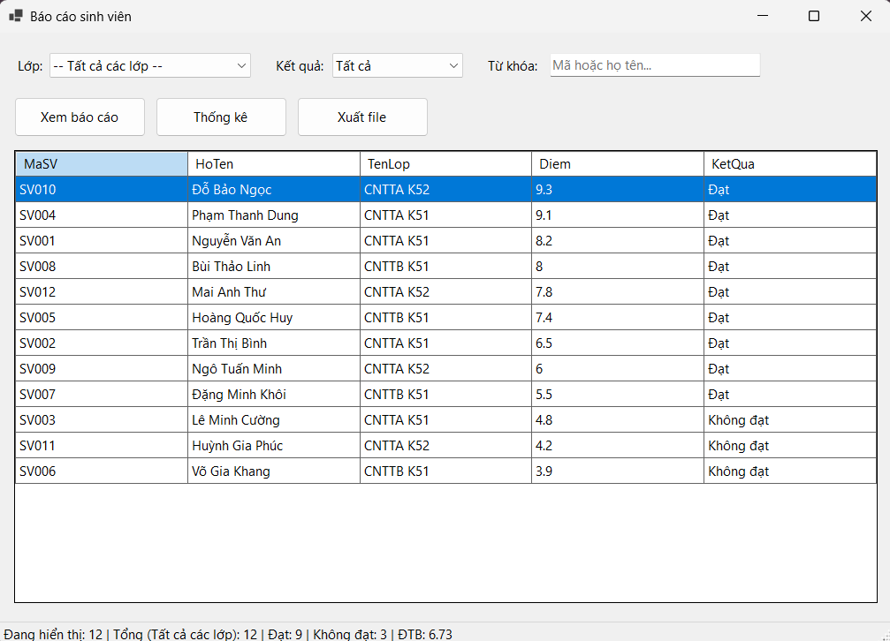
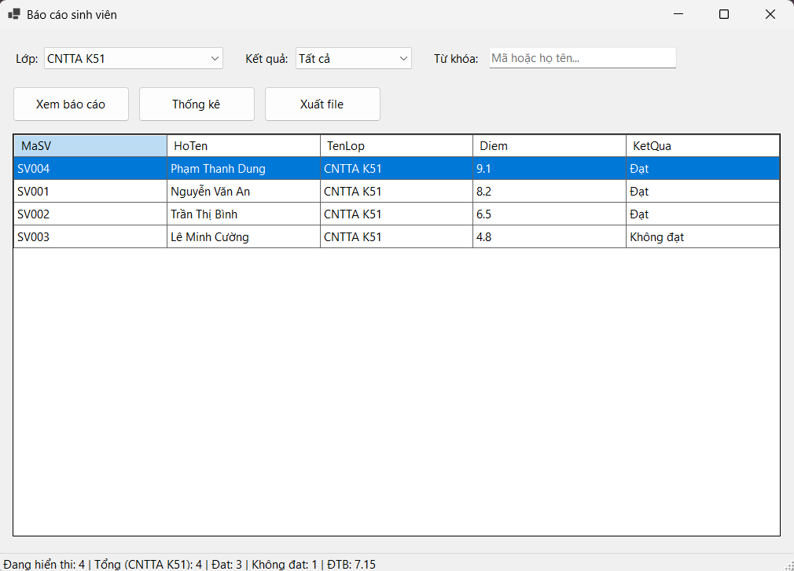
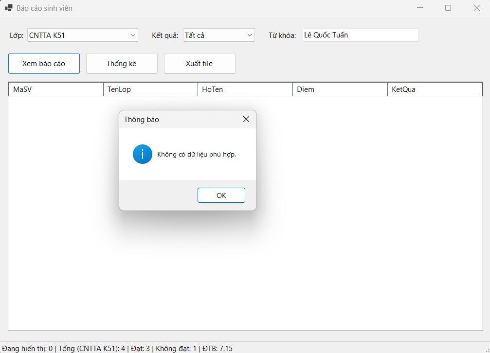
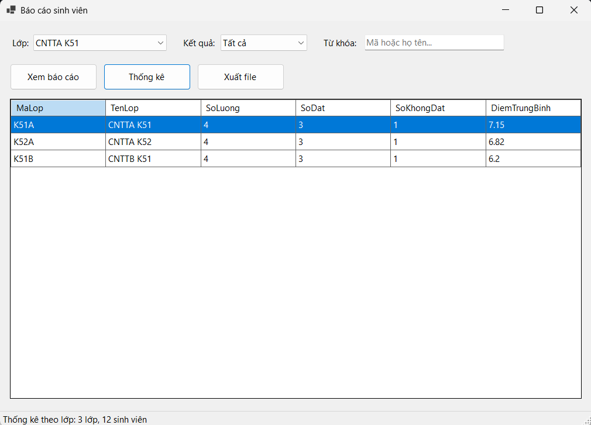
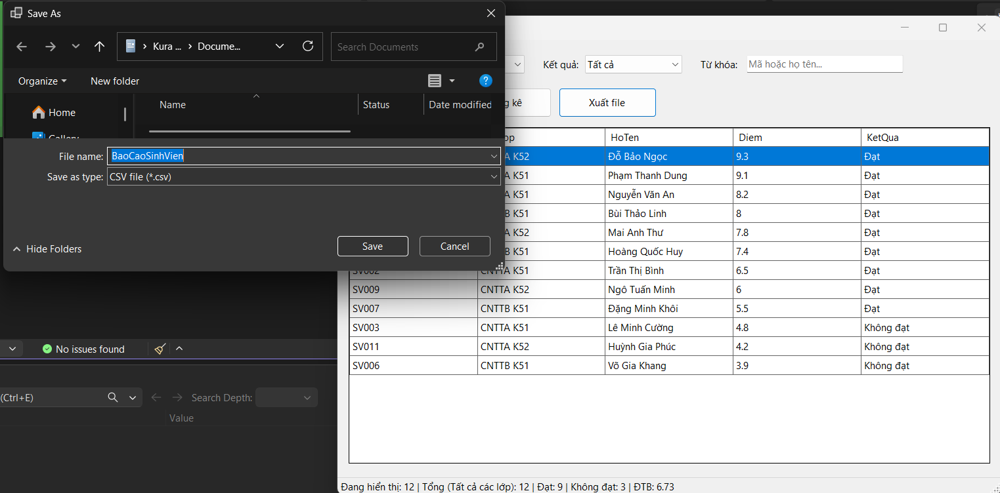

# Lab 13: Báo cáo sinh viên (WinForms)

- **Học phần:** COMP1019 - Lập trình trên Windows
- **Công nghệ:** C# WinForms, .NET 10 (`net10.0-windows7.0`), LINQ
- **Dữ liệu:** danh sách mẫu 12 sinh viên của 3 lớp, tạo sẵn trong bộ nhớ (không cần database)

## 1. Yêu cầu và cách chạy

- Windows 10/11, **.NET 10 SDK**, Visual Studio có hỗ trợ .NET 10 (workload ".NET desktop development").
- **Visual Studio:** mở `StudentReportDemo.sln` rồi nhấn `F5`.
- **Dòng lệnh:** `dotnet run --project StudentReportDemo/StudentReportDemo.csproj`

## 2. Chức năng

| Chức năng | Mô tả |
|---|---|
| Nạp dữ liệu | Khi mở form, tạo 12 sinh viên mẫu, nạp danh sách lớp vào `cboLop` (có mục "-- Tất cả các lớp --") và `cboKetQua` (Tất cả / Đạt / Không đạt) |
| Lọc tự động | Đổi lớp, đổi kết quả hoặc gõ từ khóa thì bảng tự cập nhật. Từ khóa tìm theo mã hoặc họ tên, không phân biệt hoa thường |
| Xem báo cáo | Lọc theo cả 3 điều kiện, sắp xếp điểm giảm dần (bằng điểm thì theo họ tên). Nếu không có dòng nào thì hiện "Không có dữ liệu phù hợp." |
| Thanh trạng thái | Hiện số dòng đang hiển thị, tổng số sinh viên của lớp đang chọn, số Đạt, số Không đạt và điểm trung bình |
| Thống kê | Gom nhóm theo lớp: số lượng, số đạt, số không đạt, điểm trung bình (làm tròn 2 chữ số) |
| Xuất file | Xuất nội dung đang hiển thị ra `.csv` hoặc `.txt` (UTF-8). Các ô có dấu phẩy, dấu nháy hoặc xuống dòng được bao trong dấu nháy kép. Nếu bảng trống thì báo "Không có dữ liệu để xuất." |

Quy ước kết quả: điểm **từ 5 trở lên là Đạt**, dưới 5 là Không đạt. Thuộc tính `KetQua` trong `SinhVien` được tính từ `Diem` nên không lưu riêng, tránh sai lệch khi điểm đổi.

## 3. Cấu trúc project

```
Lab13
|-- StudentReportDemo.sln
|-- StudentReportDemo
|   |-- Program.cs
|   |-- Models
|   |   |-- SinhVien.cs                  # model: MaSV, HoTen, MaLop, TenLop, Diem, KetQua
|   |-- Forms
|       |-- FrmBaoCaoSinhVien.cs         # xử lý nạp, lọc, thống kê, xuất file
|       |-- FrmBaoCaoSinhVien.Designer.cs
|       |-- FrmBaoCaoSinhVien.resx
|-- images                               # ảnh chụp màn hình
|-- README.md
```

## 4. Ảnh chụp màn hình

**1. Danh sách đầy đủ khi chọn "Tất cả các lớp": 12 sinh viên, 9 Đạt, 3 Không đạt, ĐTB 6.73, sắp xếp điểm giảm dần**



**2. Lọc theo lớp CNTTA K51: 4 sinh viên, 3 Đạt, 1 Không đạt, ĐTB 7.15**



**3. Từ khóa không có trong dữ liệu: bảng trống và hộp thoại "Không có dữ liệu phù hợp."**



**4. Nút Thống kê: 3 lớp, mỗi lớp 4 sinh viên (K51A: 7.15, K52A: 6.82, K51B: 6.2)**



**5. Nút Xuất file: hộp thoại lưu `BaoCaoSinhVien.csv`**


